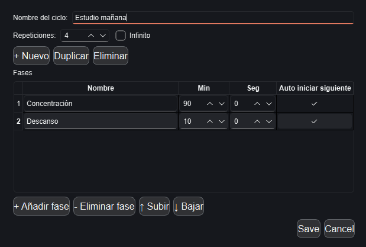

# PomoFloat


**PomoFloat** es un temporizador Pomodoro flotante, configurable y pensado para permanecer visible mientras trabajas con otras aplicaciones.

Permite crear distintos ciclos de trabajo, estudio o descanso, definir sus fases y utilizarlos desde una interfaz compacta que puede mantenerse siempre por encima del resto de ventanas en Windows.

---

## Descarga

La última versión disponible para Windows puede descargarse desde:

**[Descargar la última versión de PomoFloat](https://github.com/JoseDiazRguez/PomoFloat/releases/latest)**

Plataformas soportadas actualmente:

- Windows 10
- Windows 11

Versión pública actual:

```text
0.1.0
```

El instalador tiene el formato:

```text
PomoFloat-X.Y.Z-Setup.exe
```

Por ejemplo:

```text
PomoFloat-0.1.0-Setup.exe
```

> Windows puede mostrar un aviso de SmartScreen porque las primeras versiones de PomoFloat todavía no están firmadas digitalmente.

---

## Capturas de pantalla

> Esta sección puede completarse añadiendo imágenes del modo normal, modo compacto y configuración de ciclos.

Ejemplo de estructura recomendada:

```text
assets/
└── screenshots/
    ├── normal-mode.png
    ├── compact-mode.png
    └── cycle-editor.png
```

Después pueden mostrarse en el README así:

```markdown



```

---

## Características principales

- Múltiples presets de temporizador
- Ciclos Pomodoro configurables
- Fases completamente personalizables
- Duraciones en minutos y segundos
- Reordenación de fases
- Repeticiones finitas o infinitas
- Transiciones automáticas o manuales entre fases
- Persistencia de presets
- Persistencia de preferencias
- Modo compacto flotante
- Visualización del tiempo en formato `hh:mm:ss`
- Visualización de la fase actual
- Ventana siempre visible sobre otras aplicaciones en Windows
- Ajustes generales de la aplicación
- Instalador nativo para Windows
- Acceso desde el menú Inicio
- Acceso directo opcional en el escritorio
- Desinstalación mediante Windows

---

## Estado de funcionalidades

| Funcionalidad | Estado |
|---|---|
| Motor del temporizador | ✅ Disponible |
| Pausa y reanudación | ✅ Disponible |
| Cambio manual de fase | ✅ Disponible |
| Cambio automático de fase | ✅ Disponible |
| Ciclos configurables | ✅ Disponible |
| Múltiples presets | ✅ Disponible |
| Repeticiones infinitas | ✅ Disponible |
| Minutos y segundos por fase | ✅ Disponible |
| Reordenación de fases | ✅ Disponible |
| Persistencia de presets | ✅ Disponible |
| Persistencia de ajustes | ✅ Disponible |
| Modo compacto | ✅ Disponible |
| `hh:mm:ss` | ✅ Disponible |
| Always-on-top en Windows | ✅ Disponible |
| Instalador para Windows | ✅ Disponible |
| Configuración de tema | 🚧 En desarrollo |
| Transparencia configurable | 🚧 En desarrollo |
| Sonidos personalizados | 🗓️ Planificado |
| Control de volumen | 🗓️ Planificado |
| Notificaciones del sistema | 🗓️ Planificado |
| Mensajes de PomoFloat | 🗓️ Planificado |
| Inicio automático con Windows | 🗓️ Planificado |
| Actualizaciones automáticas | 🗓️ Planificado |
| Builds automáticas de releases | 🗓️ Planificado |

---

## Roadmap

### 0.1.x

Base funcional y distribución inicial para Windows.

- Motor Pomodoro
- Ciclos y fases configurables
- Múltiples presets
- Persistencia
- Modo compacto
- Always-on-top
- Instalador de Windows

### Próximas versiones

Entre las mejoras previstas se encuentran:

- Tema claro y oscuro
- Transparencia configurable de la ventana
- Sonidos de finalización de fase
- Control de volumen
- Notificaciones del sistema
- Mensajes configurables
- Inicio automático con Windows
- Mejora del redimensionado de ventana
- Mejoras visuales y de accesibilidad
- Automatización de builds y releases
- Sistema de actualización de PomoFloat

El roadmap puede evolucionar a medida que avance el proyecto.

---

## Instalación

Descarga la última versión desde:

**[GitHub Releases](https://github.com/JoseDiazRguez/PomoFloat/releases/latest)**

Ejecuta el archivo:

```text
PomoFloat-X.Y.Z-Setup.exe
```

y sigue los pasos del instalador.

Durante la instalación puedes elegir si quieres crear un acceso directo en el escritorio.

PomoFloat también se añadirá al menú Inicio de Windows.

---

## Tecnologías

PomoFloat está desarrollado principalmente con:

| Tecnología | Uso |
|---|---|
| Python | Lenguaje principal |
| PySide6 | Interfaz gráfica |
| Qt | Framework de escritorio |
| Pytest | Tests automatizados |
| PyInstaller | Generación del ejecutable Windows |
| Inno Setup | Creación del instalador |
| Git | Control de versiones |
| GitHub | Repositorio y releases |
| GitHub Actions | Integración continua |

---

## Arquitectura

El proyecto está organizado separando las distintas responsabilidades de la aplicación.

```text
PomoFloat
│
├── core
│   ├── Phase
│   ├── Cycle
│   ├── TimerEngine
│   └── AppSettings
│
├── services
│   ├── CycleStorage
│   ├── SettingsStorage
│   └── WindowBehavior
│
├── ui
│   ├── MainWindow
│   ├── CycleEditor
│   └── SettingsView
│
├── packaging
│   └── windows
│
└── tests
```

### `core`

Contiene la lógica de dominio de PomoFloat:

- fases;
- ciclos;
- temporizador;
- estados;
- configuración general.

La lógica principal se mantiene separada de la interfaz gráfica para facilitar su mantenimiento y sus tests.

### `services`

Contiene servicios relacionados con:

- almacenamiento de presets;
- almacenamiento de preferencias;
- comportamiento de ventanas;
- integración específica con el sistema operativo.

### `ui`

Contiene la interfaz gráfica desarrollada con PySide6.

Actualmente incluye:

- ventana principal;
- modo compacto;
- editor de ciclos;
- configuración general.

### `packaging`

Contiene la configuración necesaria para distribuir PomoFloat.

```text
packaging/
└── windows/
    ├── PomoFloat.iss
    └── version_info.txt
```

### `tests`

Contiene las pruebas automatizadas del proyecto.

---

## Desarrollo

Clona el repositorio:

```bash
git clone https://github.com/JoseDiazRguez/PomoFloat.git
cd PomoFloat
```

### Linux / WSL

Crear entorno virtual:

```bash
python -m venv .venv
```

Activarlo:

```bash
source .venv/bin/activate
```

Instalar PomoFloat:

```bash
pip install -e .
pip install -r requirements.txt
```

Ejecutar:

```bash
pomofloat
```

---

### Windows

Crear un entorno virtual:

```powershell
py -m venv .venv-win
```

Activarlo:

```powershell
.\.venv-win\Scripts\Activate.ps1
```

Instalar:

```powershell
pip install -e .
pip install -r requirements.txt
```

Ejecutar:

```powershell
pomofloat
```

---

## WSL y Windows

PomoFloat puede desarrollarse desde WSL utilizando WSLg.

Sin embargo, determinadas funcionalidades relacionadas directamente con el sistema de ventanas deben validarse de forma nativa en Windows.

Por ejemplo:

```text
Always-on-top
```

En Windows se utiliza además la API nativa mediante:

```text
HWND_TOPMOST
```

para garantizar que PomoFloat permanezca visible sobre las ventanas normales aunque otra aplicación tenga el foco.

Es posible mantener el desarrollo desde WSL y utilizar un entorno Python de Windows independiente para las pruebas nativas y las builds:

```text
.venv/       → Python Linux / WSL
.venv-win/   → Python Windows
```

---

## Tests

Ejecutar toda la suite:

```bash
pytest -v
```

Los tests cubren actualmente aspectos como:

- creación de fases;
- validación de fases;
- creación de ciclos;
- duración de ciclos;
- ciclos infinitos;
- estados del temporizador;
- pausa y reanudación;
- cambio de fase;
- cambio de repetición;
- finalización;
- reset;
- skip;
- fases manuales;
- persistencia de presets;
- orden de fases;
- duraciones exactas;
- configuración general;
- persistencia de preferencias.

Los tests también se ejecutan mediante GitHub Actions.

---

## Integración continua

El proyecto utiliza GitHub Actions para ejecutar automáticamente la suite de tests.

Actualmente se valida en distintas versiones de Python.

El objetivo es detectar regresiones antes de integrar cambios en las ramas principales.

---

## Build para Windows

La aplicación Windows se genera mediante PyInstaller utilizando:

```text
PomoFloat.spec
```

Para generar una build:

```bash
./.venv-win/Scripts/pyinstaller.exe \
    --noconfirm \
    --clean \
    PomoFloat.spec
```

El resultado se genera en:

```text
dist/PomoFloat/
```

El ejecutable principal es:

```text
dist/PomoFloat/PomoFloat.exe
```

---

## Instalador de Windows

El instalador se genera mediante Inno Setup.

La configuración se encuentra en:

```text
packaging/windows/PomoFloat.iss
```

El instalador incluye:

- archivos necesarios para ejecutar PomoFloat;
- acceso desde el menú Inicio;
- acceso directo opcional en el escritorio;
- soporte para desinstalación;
- ejecución opcional al finalizar la instalación.

El resultado tiene el formato:

```text
PomoFloat-X.Y.Z-Setup.exe
```

---

## Versionado

PomoFloat utiliza versionado semántico:

```text
MAJOR.MINOR.PATCH
```

Ejemplos:

```text
0.1.0
0.1.1
0.2.0
1.0.0
```

### PATCH

Correcciones de errores y cambios menores compatibles.

Ejemplo:

```text
0.1.0 → 0.1.1
```

### MINOR

Nuevas funcionalidades compatibles.

Ejemplo:

```text
0.1.0 → 0.2.0
```

### MAJOR

Cambios importantes o incompatibles.

Ejemplo:

```text
0.9.0 → 1.0.0
```

---

## Releases

Cada versión pública estable se identifica mediante un tag.

Ejemplo:

```bash
git tag -a v0.1.0 -m "PomoFloat 0.1.0"
git push origin v0.1.0
```

Después se publica una GitHub Release asociada al tag.

Cada release puede incluir:

- notas de versión;
- código fuente;
- instalador de Windows.

Las versiones públicas están disponibles en:

**[PomoFloat Releases](https://github.com/JoseDiazRguez/PomoFloat/releases)**

---

## Flujo de desarrollo

El flujo principal es:

```text
feature/... → develop → main
```

### `main`

Contiene las versiones estables y publicables.

### `develop`

Rama principal de integración durante el desarrollo.

### `feature/...`

Utilizadas para nuevas funcionalidades.

Ejemplo:

```text
feature/app-settings
feature/windows-packaging
```

### `bugfix/...`

Utilizadas para correcciones.

Ejemplo:

```text
bugfix/timer-reset
```

Los Pull Requests de desarrollo deben dirigirse normalmente a:

```text
develop
```

Cuando una versión está preparada para publicarse:

```text
develop → main
```

---

## Convención de commits

El proyecto utiliza Conventional Commits.

Ejemplos:

```text
feat: add Windows packaging
fix: correct timer transition behavior
test: add cycle storage tests
chore: update project configuration
```

Prefijos habituales:

| Prefijo | Uso |
|---|---|
| `feat:` | Nueva funcionalidad |
| `fix:` | Corrección |
| `test:` | Tests |
| `docs:` | Documentación |
| `refactor:` | Refactorización |
| `chore:` | Mantenimiento |

---

## Contribuciones

Las contribuciones son bienvenidas.

Flujo recomendado:

```text
1. Crear una rama desde develop
2. Implementar el cambio
3. Ejecutar los tests
4. Crear el commit
5. Publicar la rama
6. Crear Pull Request hacia develop
```

Antes de crear un Pull Request:

```bash
pytest -v
```

Todos los tests deberían pasar.

---

## Licencia

PomoFloat se distribuye bajo licencia **MIT**.

Consulta:

```text
LICENSE
```

para obtener el texto completo de la licencia.

La licencia MIT permite utilizar, modificar, copiar y distribuir el software respetando sus condiciones.

---

## Estado del proyecto

PomoFloat está actualmente en **desarrollo activo**.

Versión pública actual:

```text
0.1.0
```

Repositorio:

https://github.com/JoseDiazRguez/PomoFloat

Releases:

https://github.com/JoseDiazRguez/PomoFloat/releases
